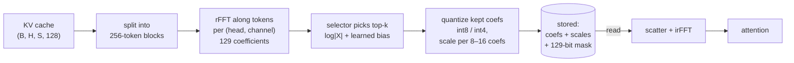
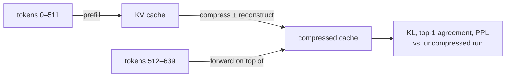

# fft-based-kv-memory-compression

Compressing a transformer's KV cache by storing a few FFT coefficients per channel instead of
the raw values, measured on Qwen3-0.6B against plain KV quantization and context truncation.

**Result: negative.** On this benchmark, FFT compression of the KV cache loses to the two
simplest baselines.

- Plain int4 KV quantization is near-lossless at **0.281x** (perplexity 27.7 vs 27.6 uncompressed).
- Keeping only the last 64 tokens, uncompressed, gives perplexity **32.7 at 0.125x**.
- The best FFT setting — sequence-axis FFT, a learned coefficient selector, int4 coefficients —
  gives **39.9 at 0.111x** and stays at 40–45 all the way down to 0.02x. Discarding the past
  entirely gives 46.2. The compressed past carries little usable information; training the
  selector mostly teaches it to make the damaged cache harmless.
- The original plan, FFT along `head_dim`, is far worse: perplexity 261,328 at half the coefficients.


| Setting | Stored bytes | KL | Top-1 agree | PPL |
|---|---:|---:|---:|---:|
| bf16 KV, full context | 1.000x | 0 | 1.000 | 27.56 |
| **past discarded entirely** | 0x | 0.66 | 0.651 | 46.20 |
| keep last 8 tokens | 0.016x | 0.47 | 0.680 | 39.15 |
| keep last 64 tokens | 0.125x | 0.24 | 0.771 | 32.71 |
| keep last 256 tokens | 0.500x | 0.09 | 0.857 | 29.04 |
| plain int8 KV | 0.531x | 0.001 | 0.981 | 27.56 |
| plain int4 KV | 0.281x | 0.007 | 0.955 | 27.70 |
| plain int2 KV, group 32 | 0.188x | 0.11 | 0.816 | 30.06 |
| plain int2 KV, group 128 | 0.141x | 0.34 | 0.688 | 36.24 |
| plain int1 KV, group 32 | 0.125x | 6.95 | 0.082 | 19,069 |
| `head_dim`-axis FFT, energy top-50% | 0.535x | 9.38 | 0.040 | 261,328 |
| sequence-axis FFT, energy top-50%, block 256 | 0.533x | 1.41 | 0.469 | 124.5 |
| sequence-axis FFT, learned top-50% | 0.533x | 0.40 | 0.657 | 35.6 |
| learned top-50% + int8 coefficients | 0.299x | 0.40 | 0.655 | 35.6 |
| learned top-25% + int4 coefficients | 0.111x | 0.55 | 0.624 | 39.9 |
| learned top-12.5% + int4 coefficients | 0.070x | 0.61 | 0.607 | 41.4 |
| learned top-3.1% + int4 coefficients | 0.020x | 0.64 | 0.593 | 42.0 |

Setup: Qwen3-0.6B (bf16, weights frozen), 640-token windows from a Gutenberg novel. The first
512 tokens are compressed in the cache; quality is measured on the next 128 tokens
(16 batches × 2 sequences = 4,096 predictions). KL is KL(teacher ‖ student) per token.
"Keep last N tokens" re-runs the model on the last N past tokens plus the evaluated ones.
"Stored bytes" is counted from the tensors the codec actually keeps — coefficients,
quantization scales and the selection bitmask — divided by the bf16 cache.

## How it works




1. **Sequence-axis block rFFT** (`seq_codec`). The cache is cut into 256-token blocks and each
   (head, channel) series of 256 values is transformed. Only the selected coefficients, their
   quantization scales and a 129-bit selection mask are kept; reads scatter them back and irFFT.
2. **Learned selector** (`SeqFreqSelector`). Score = `log|X| + bias[layer, K/V, head, freq, channel]`,
   keep the top-k. The bias starts at zero, so training starts exactly at energy top-k and any
   gain is the selector's. Top-k is trained through a straight-through estimator on the KL of the
   tokens that read the compressed cache. 7.4M parameters (1.2% of the model), ~1 minute per setting.
3. **Grouped coefficient quantization** (`coef_group`). The DC term is tens of times larger than
   the rest of a block's spectrum, so one scale per block crushes the small coefficients to zero.
   A scale per 8–16 coefficients fixes it.
4. **Byte accounting by construction.** The codec builds the storage format and reconstructs from
   it alone, so the quality numbers and the byte numbers come from the same tensors.

### Evaluation without future leakage

A sequence-axis filter mixes information from later tokens of a block into earlier ones. Applied
inside a single forward pass, a query would see the future. Compression is therefore applied the
way a KV cache is used: fill, compress, then decode on top of it.



The head-axis method is re-measured with the same protocol, so every row of the table above is
comparable.

## What moved the numbers


At a fixed budget of half the coefficients:

| Step | KL | PPL | vs. previous |
|---|---:|---:|---|
| `head_dim`-axis FFT, energy top-k | 9.38 | 261,328 | – |
| → sequence axis, block 64 | 2.15 | 276.6 | KL ÷4.4 |
| → block 256 | 1.41 | 124.5 | KL ÷1.5 |
| → learned selector | 0.40 | 35.6 | KL ÷3.5 |
| → int8 coefficients (bytes 0.533x → 0.299x) | 0.40 | 35.6 | same quality, 44% fewer bytes |

Each step is a real improvement over the one before, but the end point (KL 0.40) is still
closer to "no past at all" (KL 0.66) than to the full context. Untrained energy top-k (KL 1.41)
is *worse* than having no past: a damaged cache misleads attention more than a missing one.

### Why the sequence axis


The share of energy held by the top half of the FFT coefficients, sorted per sample. Sorting
makes even white noise score 0.84, so that, not 0.5, is the line to beat. Along `head_dim` the
K cache sits below noise (0.79) and V on it (0.84): there is nothing to compress. Along the
sequence the K cache reaches 0.89 even with the DC term removed.

## Findings

- **`head_dim`-axis FFT has no structure to exploit.** Dropping 12.5% of the coefficients already
  gives KL 4.06; dropping half gives perplexity 261,328.
- **Which coefficients are kept matters more than how many.** At 75% kept, sequence-axis KL is
  0.30 for energy top-k, 1.52 for a fixed low-pass and 2.48 for random. Low-pass barely beats
  random, so "K/V varies slowly over time" does not explain the result.
- **Longer blocks help.** KL at 50% kept: 2.70 / 2.15 / 1.75 / 1.41 for blocks of 32 / 64 / 128 / 256.
  The cost is that up to 255 recent tokens stay uncompressed.
- **RoPE is not the problem.** The K spectrum shows a RoPE peak (bin ≈ 41), but undoing RoPE before
  compressing leaves KL unchanged (0.304 → 0.306).
- **Separate K/V budgets do not pay.** K is more sensitive than V, and K-heavy splits beat V-heavy
  ones (KL 0.73 vs 1.00 at 0.662x), but an even split at the same size is better still (0.59 at 0.666x).
- **Learning helps most where compression is hardest.** Energy → learned KL: 0.20 → 0.16 at 75% kept,
  1.41 → 0.40 at 50%, 4.35 → 0.54 at 25% (perplexity 2,210 → 39.6). Energy-optimal coefficients are
  not the ones attention needs.
- **int8 coefficients are free; int4 needs grouped scales.** int8 keeps KL at 0.40 while bytes drop
  0.533x → 0.299x. int4 at 100% kept: KL 3.26 with one scale per block, 0.65 per 32 coefficients,
  0.12 per 8.
- **Plain quantization is the bar above 0.14x.** int4 KV is near-lossless at 0.281x (KL 0.007).
  int2 with group 32 reaches perplexity 30.1 at 0.188x, against 36.9 for the FFT route at 0.189x.
  Dropping coefficients costs more than rounding them. Below 2 bits it stops working: int1 gives
  perplexity above 19,000.
- **Truncation is the bar below 0.14x, and FFT does not clear it.** Keeping the last 64 tokens
  (0.125x) gives perplexity 32.7; the last 8 tokens (0.016x) give 39.2. The FFT route gives 39.9 at
  0.111x and 42.0 at 0.020x.
- **The FFT curve is flat because the compressed past is barely used.** From 0.28x to 0.02x its KL
  only moves from 0.53 to 0.64, next to the 0.66 of discarding the past. A method that keeps
  information would degrade as bytes are removed.
- **This benchmark has little long-range signal.** Full context is worth perplexity 27.6 vs 46.2
  with none, and the last 64 tokens already recover most of it. A task that needs the far past
  (retrieval, long-document QA) would separate the methods more sharply.

## Limitations

- One 0.6B model, one book; 4,096 evaluated tokens. Next-token perplexity on a novel rewards
  recent context, so it understates what a faithful cache is worth.
- A single 512-token compressed span. Long contexts and block-by-block updates during generation
  are not measured.
- No speed measurement. Every block adds an FFT on write and an irFFT on read.
- `SparseSpectralCache` (section 7 of the notebook) is the `head_dim`-axis prototype and ignores
  `active_layers`; a sequence-axis cache for `generate()` is not written yet.
- Training is not bit-reproducible on GPU; KL moves by about ±0.01 between runs.

## Next

- **Evaluate on a task that needs the far past** (passkey retrieval, long-document QA). On such a
  task truncation fails outright, which is the only regime where a lossy codec can earn its bytes.
- **FFT on the quantization residual.** Store plain int2 and correct only its residual with
  sequence-axis FFT, instead of replacing the values with coefficients.
- **Per-frequency bit allocation** (transform coding with a DCT) instead of keep-or-drop.

## Reproducing

```
pip install -r requirements.txt
jupyter notebook fft_kv_compression.ipynb   # sections 0–1 (setup), 2 (spectrum), 9–10
```

Section 9 runs in a few minutes on one GPU (RTX 5080 here). Sections 2–8 hold the earlier
`head_dim`-axis experiments, including selector training for that axis.

| File | Contents |
|---|---|
| `custom_layers.py` | `seq_codec`, `raw_codec`, `head_codec`, `SeqFreqSelector`, `seq_filter_ste`; head-axis `KVFreqCompressor`, `FFTCompressedCache`, `SparseSpectralCache` |
| `tools.py` | model and data loading, `evaluate_prefix`, `compress_cache_`, `train_seq_selector`, spectrum statistics |
| `fft_kv_compression.ipynb` | all experiments and the conclusion (Korean) |
| `results/fft_kv_summary.json` | every measurement behind the tables |

## Background: where the KV cache shows up in `generate()`

This repo started as a memory and speed study of `model.generate()`, which is what pointed at
the KV cache in the first place.

Memory and inference-speed optimization of PyTorch/Transformers `generate()`, measured
against vLLM.

`model.generate(output_logits=True)` keeps one full-vocabulary logit row per decode step
and returns all of them, so any per-step analysis can only happen after the loop ends.
Writing the decode loop out by hand and reducing each step in place removes that term.
This measures what the two cost, and puts vLLM beside them for scale.

Measured on an RTX 5080 (16 GB) with Qwen3-4B-FP8, greedy decoding, 31-token prompt.
Another process held 4218 MiB of the card throughout.

### Speed — tokens/sec

| max_tokens | vLLM | `generate()` | manual loop |
| ---------: | ---: | -----------: | ----------: |
|         32 | **154.9** | 49.8 | 49.9 |
|        128 | **157.1** | 49.4 | 50.0 |
|        512 | **157.6** | 49.3 | 49.7 |

vLLM is ~3.2x faster. `generate()` and the hand-written loop are indistinguishable: the
cost is in the forward pass, not in the Python loop around it.

### Decode memory — MiB above the weights

| max_tokens | vLLM | `generate()` | manual loop |
| ---------: | ---: | -----------: | ----------: |
|         32 |  0.0 | 29.0 | **15.7** |
|        128 |  0.0 | 98.1 | **24.8** |
|        512 |  0.0 | 406.6 | **125.5** |

The gap divided by step count converges on the size of one float32 logit row
(`151936 x 4 B = 0.580 MiB`):

| max_tokens | extra MiB | per step |
| ---------: | --------: | -------: |
|         32 |      13.3 |    0.417 |
|        128 |      73.3 |    0.573 |
|        512 |     281.1 |    0.549 |

At 512 steps that retained-logits term is 69% of what decoding cost `generate()`.

### Two things the numbers correct

**The manual loop is not constant-memory.** It grows 15.7 -> 24.8 -> 125.5 MiB, because
the KV cache grows with sequence length no matter how the loop is written. Both paths pay
that term linearly; `generate()` pays a second linear term on top. Only the second one is
removable.

| max_tokens | seq len | manual decode | of which KV cache* |
| ---------: | ------: | ------------: | -----------------: |
|         32 |      63 |          15.7 |                8.9 |
|        128 |     159 |          24.8 |               22.4 |
|        512 |     543 |         125.5 |               76.4 |

\*computed from the architecture (36 layers, 8 KV heads, head_dim 128, bf16), not measured.

**vLLM's 0.0 is not a win.** Its server claims `--gpu-memory-utilization` of the card at
startup — 9860 MiB here, flat across every budget — and works inside that slab. The
per-request delta is zero because the cost was paid up front, not because it is absent.
vLLM's memory figure is also an `nvidia-smi` sample of another process, not a torch
allocator peak, so it is not on the same axis. The comparison vLLM genuinely contributes
here is speed.

### Running it

Each script is standalone — no shared module, no package to install from this repo.

```
# with a vLLM server on localhost:8000 serving as "local"
python run_vllm.py

# with every vLLM server stopped (it reserves VRAM at startup, so idle is not enough)
python run_generate.py
python run_manual.py
```

Each writes `results/<path>.json` after every budget, so an OOM on a long run does not
discard the budgets that already succeeded.

The scripts print how much GPU memory other processes hold and warn above 500 MiB. A
shared card skews the peaks and can OOM a long run outright — the figure is recorded in
each result file's `meta` so a surprising measurement can be explained later.

### Requirements

```
pip install -r requirements.txt
```

CUDA is required. The FP8 checkpoint needs Triton kernels, which need Python headers
(`sudo apt install python3.12-dev`) and the `kernels` package; a bf16 model such as
`Qwen/Qwen3-0.6B` avoids the FP8 path but still uses Triton on recent torch builds.
Change `MODEL` at the top of each script to switch.
